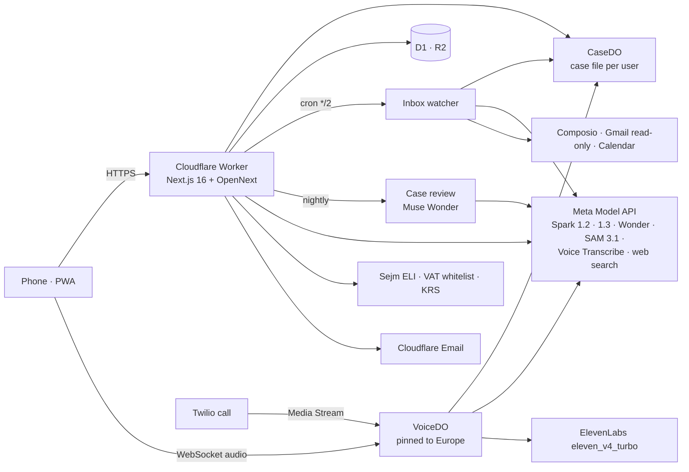

# Dossierly

[](https://github.com/gabrielantonyxaviour/dossierly-meta/actions/workflows/ci.yml)  

**A personal AI caseworker for newcomers in Poland, built on Meta Muse.** Dossierly reads every official letter, email and screen that reaches you, keeps one case file with the deadlines worked out from the actual law, interprets for you at the immigration counter in real time, and phones you when something urgent arrives. It guides; it never submits anything to a government system on your behalf, and it never gives legal advice.

- **Live:** https://dossierly.cosmiclan.com (mobile-first; add it to your home screen)
- **Demo video:** _link added at submission_
- **Track:** Indie · theme "Build for Your World"
- Built for the Meta Global AI Developer Hackathon (Oct 26 – Nov 4, 2026).

## Try it as a judge

Sign in with your email (a 6-digit code). Dossierly works without connecting anything:
- **Look** → "No document handy? Use a test letter" reads a fictional summons live: Muse Spark finds the facts, SAM 3.1 outlines them on the page, and the deadline is computed from the Polish Code of Administrative Procedure with the articles quoted.
- **Counter** → "Play a test official" feeds a recorded Polish official into the real speech pipeline, so you can see live interpreting without a Polish speaker.
- **Talk** → call your caseworker by voice any time; it knows your whole case.
- Gmail and Google Calendar connect for real but our Google app is still in Google's testing mode, so only approved test accounts can grant access until Google's review completes. Phone calls from the agent are enabled for the demo account only (Twilio trial); everyone else gets in-app and email alerts.

All sample letters, emails and people are fictional and labelled `PRZYKŁAD / SAMPLE`.

## 60-second tour of the code

| Look at | Why it is interesting |
|---|---|
| [`src/lib/voice/server/session.ts`](src/lib/voice/server/session.ts) | Realtime voice turn: the model starts on the last partial transcript at speech end and is cancelled and redone if the final transcript differs, before anything is spoken |
| [`src/lib/voice/server/modes/counter.ts`](src/lib/voice/server/modes/counter.ts) | Counter interpreting: a bare Spark 1.2 lane for speech, side lanes for the coach card (Spark 1.3 raced against 1.2) and requested documents |
| [`src/lib/look/read.ts`](src/lib/look/read.ts) · [`outline.ts`](src/lib/look/outline.ts) | Look: two Spark 1.3 calls in parallel (reading, grounding), then SAM 3.1 box prompts traced to outlines on the user's own photo |
| [`src/lib/legal/deadlines.ts`](src/lib/legal/deadlines.ts) | The KPA deadline engine: pure code, verbatim articles, 2,000-case property tests |
| [`src/lib/watch/process.ts`](src/lib/watch/process.ts) | The 24/7 inbox agent: claim, read, write the case, then notify; idempotent per message |
| [`src/lib/strategist/agent.ts`](src/lib/strategist/agent.ts) | Muse Wonder case review: a bounded tool loop with a per-user budget; proposals never overwrite facts |
| [`src/lib/model/`](src/lib/model) | One model layer: role routing, reserve-then-settle metering, the western-Europe relay for edge 404s |
| [`eval/`](eval) | The model evaluation that chose each model, run through the product's own code |

Docs: [architecture](docs/architecture.md) (sequence diagrams, Durable Objects, measured latency) · [models](docs/models.md) (who does what and why, spend control) · [deadline engine](docs/deadline-engine.md) · [safety](docs/safety.md) · [evaluation](docs/eval.md) · [MCP server](docs/mcp.md)

## The problem

A non-EU student or worker in Poland must keep a residence case alive for months, in Polish, with no caseworker:
- Applications for temporary residence must be filed online in **MOS** since **27 April 2026** (Profil Zaufany login; students also need a university attachment).
- The legal limit for a decision is **60 days** (art. 112a, Act on Foreigners); real cases take many months — forum reports range from 3–4 months to 1.5 years, and a Sejm interpellation (no. 18089, June 2026) describes a single case of about 16 months.
- **112,300** temporary-residence applications were filed in Q1 2026 alone (UdSC). Poland's supreme audit office (NIK) found about **60%** of sampled cases handled in breach of the rules, mostly through delay; foreigners sent the Ombudsman **3,992** complaints in 2025.
- A summons (*wezwanie*, KPA art. 64 §2) usually gives 7–14 days counted from delivery; miss it and the application is left unexamined. An uncollected letter counts as delivered after 14 days (art. 44); a letter to an old address counts as delivered if you didn't report the move (art. 41 §2).
- People report Polish-only counters, phone lines nobody answers, sworn translations at up to 44.07 zł a page, and agencies quoting thousands of złoty.
Sources for every number are in the submission write-up; figures we could not verify (e.g. a widely quoted "394-day" average) are deliberately not used.

## What Dossierly does

| Moment | What happens | Meta models doing the work |
|---|---|---|
| **Onboarding** | Talk to it ("I'm Arjun, student, I've got a letter I can't read"). Connect Gmail and Calendar; it reads the official emails and builds the case: case number, filing date, application address, documents already in hand, what's missing, the summons deadline, the fingerprint appointment. | Muse Voice Transcribe (realtime) · Muse Spark 1.2 (spoken reply, streamed) · Muse Spark 1.3 (reading mail + attachments) |
| **Welcome call** | The agent explains, out loud, what it found and what to do next, and puts the dates in your calendar. | Voice Transcribe · Spark 1.2 · ElevenLabs `eleven_v4_turbo` |
| **Look** | Photograph or screenshot anything official (letter, MOS screen, UPO receipt, inPOL status, ticket kiosk). The facts are outlined on your own photo and written to the case with their source. | Spark 1.3 perception grounding → **SAM 3.1** box-prompt refinement · deterministic KPA engine |
| **Deadlines** | Due dates computed in code from the delivery date: art. 57 §1 (day not counted), §4 (Saturday/holiday rule), §5 (posting counts), art. 44, 64 §2 — each step shown, articles quoted from the official text (Sejm ELI API). | none needed (deterministic by design) |
| **Counter** | Phone flat on the desk; the official's half shows Polish, yours shows your language. Live two-way interpreting (2.1–3.0 s from the end of speech to the spoken translation, measured on the client across our demo recordings; per-turn timings are not persisted), the requested document appears on the official's side instantly, a coach card explains what the official really needs given *your* case (e.g. address mismatch → art. 41), and requests become tasks. Rehearse mode simulates the official. | Voice Transcribe (endpointing, keywords from the case) · Spark 1.2 minimal (turns) · Spark 1.3 raced against 1.2 (coach) · ElevenLabs |
| **24/7 agent** | Every 2 minutes it checks the connected inbox; a new official letter is read, drafts are prepared (reply to the office, request to the dean's office), the deadline and reminders are set, and the agent **phones you** about it (demo account). | Spark 1.3 · Twilio Media Streams ↔ Voice Transcribe + Spark + ElevenLabs |
| **Case review** | Nightly and after every new letter, Meta's most capable model reviews the whole case with the law texts in a multi-step tool loop: risk register, dated plan, inconsistencies, questions, proposed tasks. | **Muse Wonder 1.0** (tools: case items, deadline engine, article lookup) |
| **Visit plan** | Checklist for the next appointment from today's official pages, with citations, compared against your documents. | Spark 1.3 + Meta **web search** grounding |
| **Photo check** | MOS photo rules (684×883 px, 35×45, ≤2.5 MB, plain background, no hat…), exact crop, never retouched. | SAM 3.1 + Spark 1.3 |
| **Connector for other agents** | A remote MCP server exposes Dossierly's verified tools (case, next step, deadline engine, read letter, explain law, interpret) to any agent — Muse included. See [docs/mcp.md](docs/mcp.md). | all of the above |

Also: employer verification against Poland's VAT whitelist and KRS registers, and a MOS field sheet prefilled from the case.

## Why each model does what it does (measured)

We evaluated the production letter pipeline on 28 fictional Polish official letters plus photo-like variants across Muse Spark 1.1/1.2/1.3 and Muse Wonder ([docs/eval.md](docs/eval.md), ~US$14.7 of live calls):

| config | deadline correct | Spark box IoU | after SAM 3.1 | IoU ≥ 0.5 after SAM | cost / letter |
|---|---|---|---|---|---|
| Spark 1.1 low | 100% | 0.30 | 0.39 | 42% | $0.027 |
| Spark 1.2 low | 98% | 0.26 | 0.36 | 38% | $0.031 |
| **Spark 1.3 low** (production) | 100% | 0.54 | **0.63** | **77%** | $0.033 |
| Spark 1.3 high | 100% | 0.55 | 0.64 | 79% | $0.041 |
| Wonder 1.0 low | 100% | 0.51 | 0.62 | 73% | $0.109 |

Extraction is saturated, so the model only *reads* the deadline sentence and the date arithmetic stays in code. Spark 1.3 grounds about twice as well as 1.1/1.2, and SAM 3.1 adds +0.09–0.11 IoU on every model. Spark 1.2 at minimal reasoning is the fastest for text-only turns (interpreting, guard), so the counter uses it; Wonder matches 1.3 on letters at 3.3× the cost, so it does the long-horizon case review instead.

## Architecture



- **One model layer** (`src/lib/model`) routes by role (interpret, guard, reason, agent, vision, draft, plus the sam, asr and search services) with per-role environment overrides, so any role can move to open-weights Muse Spark Open on Fireworks/Baseten/Modal without code changes.
- **Case file** in a per-user Durable Object: profile, facts with their source (email, letter, screenshot, call, user), documents, deadlines with computation steps, tasks, timeline, appointments. Every agent gets the whole case as context; dates are spelled out with weekdays so models never do calendar arithmetic.
- **Voice** runs in a Durable Object pinned to western Europe (Meta's API rejects some Asian edge locations); turns start on the last partial transcript and are confirmed by the final one; an echo guard gates the mic while the phone speaks.
- **Safety:** an interpret-only guard model screens every text interpret turn (live voice turns carry the same rules in the prompt); names, addresses and ID numbers in case context, mail text and typed text are masked before they reach a model (images cannot be masked, and live voice sessions keep the name so the caseworker can address you); the agent never logs into government systems or submits anything; proposals from the case review never overwrite confirmed facts. See [docs/safety.md](docs/safety.md).

More: [docs/architecture.md](docs/architecture.md) has the request paths as sequence diagrams and the measured latency table.

## What was built for this hackathon

Dossierly started as a version built during the Nebius × NVIDIA Global AI Hackathon (also inside this event's window, from 30 Oct 2026). For Meta we created this repository and rebuilt the product on Meta's models:
- New: the Meta model layer (Spark 1.2/1.3, Wonder, SAM 3.1, Voice Transcribe, web search), realtime voice-to-voice interpreting and coaching, voice onboarding, the welcome call, the 24/7 inbox agent, outbound phone calls, Look with SAM outlines, the Muse Wonder case review, the MCP connector, the server-side case file, the KPA deadline engine with quoted articles, photo check, MOS sheet, registries, the evaluation, and a mobile-first redesign.
- Removed from the earlier version: payments and plans, NVIDIA/Nebius models and sandboxes, the Mac speech bridge, passkeys and the browser-only case vault.

## Limits we're honest about
- Google's app review is pending, so Gmail/Calendar work only for approved test accounts; the consent screen still names our OAuth broker (Composio).
- Phone calls go to verified numbers only (Twilio trial); production users get "calls coming soon".
- Muse Voice Transcribe doesn't support Ukrainian or Russian yet; those users get text.
- Guidance, not legal advice. Real cases differ; for a decision that matters, talk to a lawyer or a migrant legal-aid organisation.

## Run it

```bash
npm install
npm run dev            # http://localhost:3000
npm test               # 520 unit tests (vitest, about 3 s)
npm run lint && npm run typecheck
npm run smoke:meta     # one live call per Meta helper (needs MODEL_API_KEY)
npm run eval:report    # evaluation tables from eval/results (offline)
npm run latency        # per-task latency and cost from D1 (read-only, needs wrangler login)
npm run deploy:prod    # Cloudflare (see wrangler.jsonc and scripts/put-secrets.sh)
```

Environment: `MODEL_API_KEY` (Meta Model API), `ELEVENLABS_API_KEY`, `COMPOSIO_*`, `TWILIO_*`, `SESSION_SECRET`; optional `MODEL_<ROLE>_BASE_URL/_MODEL/_KEY_ENV/_EFFORT` to move a role to another OpenAI-compatible provider.

## License
MIT
