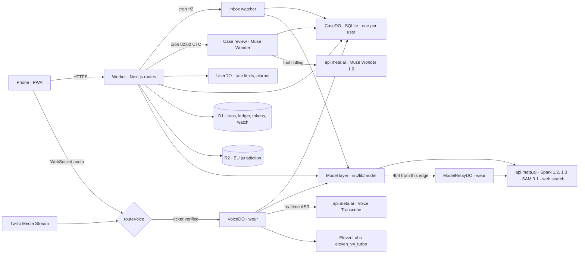
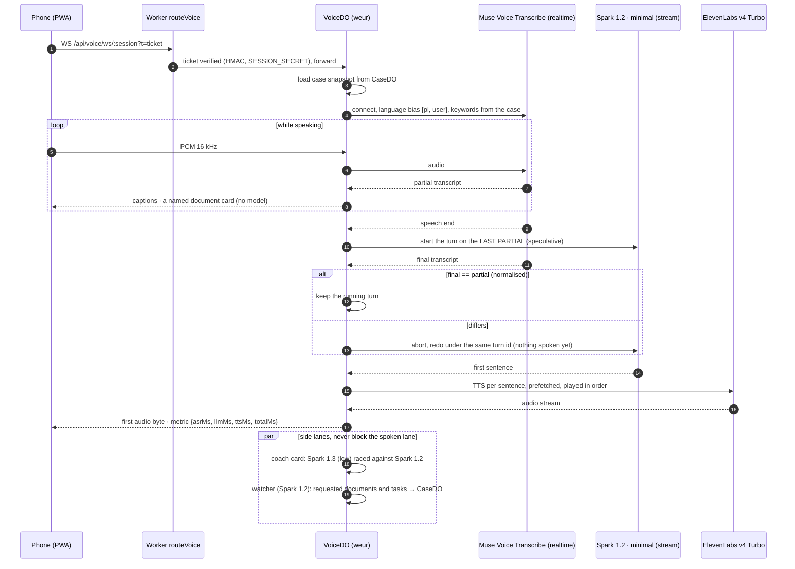
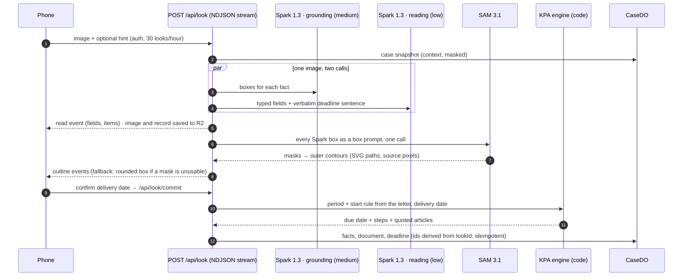
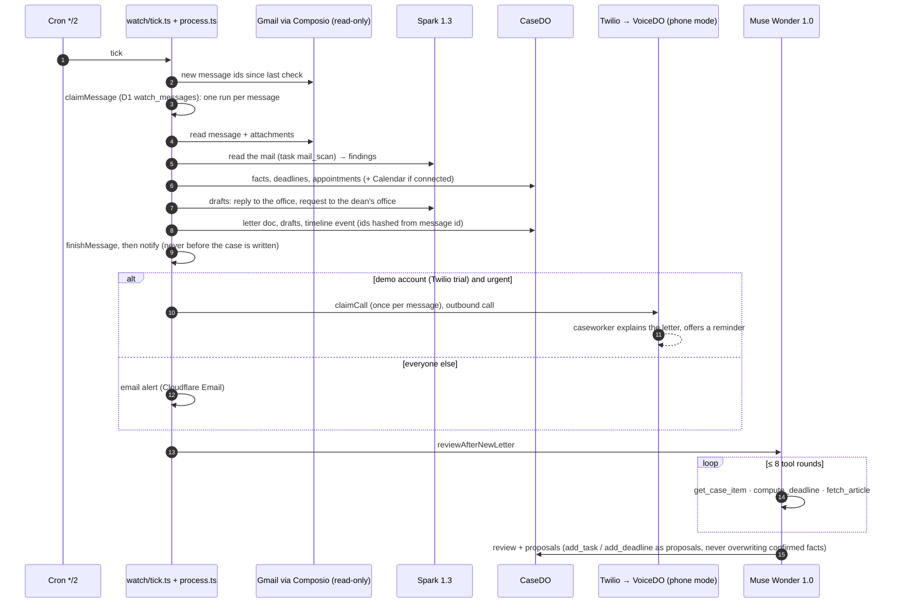

# Architecture

Dossierly is one Cloudflare Worker: the Next.js 16 app (built with OpenNext) plus a thin entry (`worker/index.ts`) that routes voice WebSockets to a Durable Object and runs two crons. Model calls go through one model layer (`src/lib/model`): app routes and the watcher through `runModel` (masking, metering, run records), the voice lanes through its streaming client directly. The Wonder tool loop and the realtime ASR socket have their own clients, configured by the same role table.

## Durable Objects and scheduled work

| Unit | Key | Holds / does | Code |
|---|---|---|---|
| `CaseDO` | `idFromName(userId)` | The case file in Durable Object SQLite: profile, facts with source, documents, deadlines (with computation steps), tasks, timeline, appointments. Every agent reads the whole snapshot. | `worker/case-do.ts` → `src/lib/case/store.ts` |
| `UserDO` | per user | Rate limits, deadline alarms (`{date, label}` only). | `worker/user-do.ts` → `src/lib/server/userstate.ts` |
| `VoiceDO` | `idFromName(sessionId)`, `locationHint: "weur"` | One live voice session: ASR socket, mode handler, TTS queue, turn metrics. Pinned to western Europe because Meta's API answered 404 from some edge locations (seen: HKG). `VOICE_DO_LOCATION` overrides. | `worker/voice-do.ts` → `src/lib/voice/server/*` |
| `ModelRelayDO` | pool of 4, `locationHint: "weur"` | A model call that gets a 404 is re-sent once from western Europe; `MODEL_RELAY_MODE=always` routes every Meta call through it. | `worker/model-relay-do.ts`, `src/lib/model/relay.ts` |
| Cron `*/2 * * * *` | | Inbox watcher over connected accounts (≤25 accounts, ≤3 new messages each, 5 in parallel). | `src/lib/watch/tick.ts` |
| Cron `0 2 * * *` | | Muse Wonder review of cases whose revision changed (up to 15 per run, US$0.50 per user per day); also starts the `NightlyWatch` Workflow (official-pages watch), id `nightly-<day>` so a double fire is a no-op. | `worker/index.ts`, `src/lib/strategist/service.ts` |

## 1 · Realtime voice turn (counter mode)

The phone sits flat between the user and the official. The official speaks Polish; the user hears it in their language.

- **Speculation** (`session.ts` `speculate` / `onFinal`): the turn starts at speech end instead of waiting for the final transcript; a mismatch is cancelled before any audio is spoken.
- **Merge window** (`holdForMore`): a speaker who pauses mid-sentence and continues within `MERGE_MS` is translated as one turn.
- **Ordered speech** (`speaker.ts`): each sentence's TTS request starts the moment it is queued, playback stays in order.
- **Twilio**: the same `VoiceDO` runs phone mode over a Media Stream (μ-law 8 kHz both ways); the ticket is the path because Twilio drops query strings.

## 2 · Look (photo or screenshot → outlined facts → deadline)

The model only reads the period and the sentence that sets it; the date arithmetic is `src/lib/legal/deadlines.ts`. See [deadline-engine.md](deadline-engine.md).

## 3 · Inbox watcher → phone call → Wonder review

Idempotency: message claims, call claims and every case id derive from the provider message id, so a retried or overlapping tick updates the same rows. `tests/unit/watch-tick.test.ts` and `tests/unit/watch.test.ts` cover it.

## Latency, measured

Only numbers we recorded. Re-run: `npm run latency` (D1 `runs`, read-only) and `npm run eval:report` (offline, from `eval/results`).

| Path | What is timed | n | p50 | p95 | Source |
|---|---|---|---|---|---|
| Counter voice turn | End of speech → first translated audio on the phone | demo takes | 2.1–3.0 s (range) | | App's per-turn readout ("Last reply"), measured on the client during our demo recordings; per-turn timings are not persisted |
| Voice onboarding reply | One Spark 1.2 minimal call | 45 | 2.1 s | 3.1 s | D1 `runs` |
| Reading an official mail | One Spark 1.3 low call, attachments as images | 54 | 7.3 s | 18.3 s | D1 `runs` |
| Drafts and welcome narrative | One Spark 1.3 low call | 27 | 5.4 s | 11.6 s | D1 `runs` |
| Look, one Spark 1.3 call | Reading or grounding (the two run in parallel) | 4 | 15.6 s | 19.4 s | D1 `runs` |
| Look, whole read | Both Spark 1.3 calls, retries included | 56 | 19.0 s | 26.6 s | [eval.md](eval.md) |
| SAM 3.1 outlines | One call, every box at once | 56 | 2.7 s | | [eval.md](eval.md) |
| Photo check | One Spark 1.3 call | 2 | 7.8 s | | D1 `runs` |

D1 rows: 134 cloud runs on the preview environment, 4 Nov 13:35 to 5 Nov 07:09 MYT, real use during development and recording (`npm run latency`). The production table was empty at the time of writing. Small samples (n ≤ 4) are shown for completeness, not as benchmarks.

## Where things live

| Path | What |
|---|---|
| `worker/` | Worker entry, Durable Object and Workflow shells (logic lives in `src/lib`) |
| `src/lib/model` | Meta provider (chat, stream, responses, ASR), role routing, cost, metering, relay |
| `src/lib/voice` | Realtime voice: protocol, server session and modes, client hooks |
| `src/lib/look` | Look: Spark reading and grounding, SAM outlines, photo check, commit |
| `src/lib/legal` | KPA deadline engine, holidays, quoted articles, MOS sheet, address-change notice |
| `src/lib/watch` | Inbox watcher, letter builders, drafts, notifications |
| `src/lib/strategist` | Muse Wonder case review (tool loop, budget, storage of proposals) |
| `src/lib/mcp` | Remote MCP server, tokens, tools ([mcp.md](mcp.md)) |
| `src/lib/case` | Case store (CaseDO), context builder, next step |
| `eval/` | Model evaluation harness and results ([eval.md](eval.md)) |
